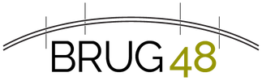

# Huisstijl en design-richting: Brug 48

Fase 1, 13-10-2026. Bron: brug48.be (Weebly), logo, headerfoto en theme-CSS. Hier staat wat er
nu is, wat we zeker meenemen, en drie richtingen om uit te kiezen. Bij de STOP van fase 1 kies
je er één; daarna komt het definitieve `DESIGN.md`.

## Wat er nu is

### Logo

- Een brug: een **boog** (het brugdek) over **vier verticale lijnen** (de pijlers), met
  daaronder het woordmerk **BRUG** in een dunne geometrische schreefloze letter (familie
  Futura/Century Gothic) en **48** in olijf.
- Enkel als PNG, 323×100 px, transparant. Geen vector. Als header-logo van ±160 px breed is
  dat nog net scherp op retina (2×), groter niet. **Vectorbestand vragen aan de praktijk.**
- Bestand: `assets/img/bron/brug48-logo.png`.

### Kleuren

| Rol | Hex | Bron | Contrast op wit | Bruikbaar als |
|---|---|---|---|---|
| Logo-olijf | `#969606` | "48" in het logo | 3,2:1 | accent, vlak, grote tekst ≥ 24 px |
| Site-olijf | `#AFAB55` | balk op elke therapeutenpagina | 2,4:1 | vlak (zwarte tekst erop: 6,8:1) |
| Logo-zwart | `#231F20` | "BRUG" in het logo | 16,3:1 | koppen, tekst |
| Kopgrijs | `#2A2A2A` | koppen therapeutenpagina's | 14,4:1 | koppen |
| Tekstgrijs | `#626262` | lopende tekst | 6,1:1 | lopende tekst |
| Crème | `#F0EEDE` | lucht in de headerfoto | n.v.t. | achtergrond |
| Diep olijf | `#4B5017` | schaduwen in de headerfoto | 8,5:1 | links, knoppen, actieve filter |

Belangrijk voor toegankelijkheid: **de olijf uit het logo haalt AA niet als tekstkleur.**
Olijf blijft het herkenningsteken (vlakken, lijnen, de boog, "48"), maar tekst, links en
knoppen krijgen de diepe olijf `#4B5017` uit de foto. Zo blijft het herkenbaar en haalt het AA.

### Lettertypes op de huidige site

- **Crimson Text** (schreef): koppen
- **Quattrocento** (schreef): lopende tekst, 18 px
- **Raleway** (schreefloos): menu, en de headline in hoofdletters
- **Montserrat**: sitetitel (niet zichtbaar, het logo is een beeld)
- Het logo zelf: dunne geometrische schreefloze

De praktijk communiceert dus al in een **klassieke schreef voor tekst** en een **geometrische
schreefloze voor het merk**. Die tweedeling houden we, met modernere letters.

### Beeld

- **Headerfoto** (`assets/img/bron/6806649.jpg`, 1754×1240): een brug met fietsers (vermoedelijk de Gentbruggebrug, niet bevestigd),
  in een **olijf-duotoon** van crème naar diep olijf. Dit is het sterkste merkbeeld dat ze
  hebben. Bronvermelding "foto Fietsbult / blog van Fietsersbond Gent" blijft staan; de rechten
  moeten gecheckt worden.
- **Locatiefoto** (`assets/img/bron/1968579996.jpg`, 2000×1334): dronefoto van Residentie
  Evrard. Watermerk linksonder en "TE KOOP"-borden aan de gevel: gedateerd, en de bron is
  onbekend.
- **Portretten**: 10 van de 11 therapeuten hebben er één, maar ze zijn klein en allemaal
  anders: 153 tot 478 px (enkel Uus 1024 px), één zwart-wit, één al rond uitgesneden met zwarte
  hoeken, de rest vakantie- of gsm-foto's in kleur. Grotere versies staan niet op Weebly.
  Kristien Lemaitre heeft geen foto.

### Opbouw nu

Weebly-thema "Unite": wit, gecentreerd, een olijfbalk met foto en naam bovenaan elke
therapeutenpagina, daaronder twee kolommen (tekst links, opleiding/doelgroep/contact rechts).
Therapeuten zijn enkel via een uitklapmenu bereikbaar; er is geen overzicht en geen manier
om op thema te zoeken.

## Wat elke richting meeneemt

1. **Licht thema**, ook geen donkere secties (no-go).
2. **Olijf + bijna-zwart** als merkkleuren, crème als warme ondergrond, diep olijf voor
   interactie.
3. **Het brugmotief uit het logo zelf**: de boog en de vier pijlers. Geen stockbrug, geen
   illustratie: lijnen die al in hun logo zitten.
4. **Eén vaste behandeling voor alle portretten**, zodat elf verschillende kiekjes één reeks
   worden. Voorstel: zacht olijf-duotoon zoals de headerfoto, in een kader met een boogvormige
   bovenkant. Klein getoond (max. ±200 px), omdat de bronnen niet groter zijn.
5. **Kristien zonder foto** krijgt hetzelfde boogkader met haar initialen, geen verzonnen beeld.
6. **Lettertypes lokaal** (OFL, `woff2`), geen CDN.
7. **Beweging**: traag (600 tot 1200 ms), zachte easing, enkel fade en kleine verschuivingen.
   Geen scrolljacking. Bij `prefers-reduced-motion` alles uit.

## Drie richtingen

### A. Pijlers (editoriaal, architecturaal)

**Idee:** de site is gebouwd zoals hun logo. Een rustig raster met **vier dunne verticale
lijnen** als pijlers, die over de hele pagina doorlopen en de kolommen dragen. Bovenaan elke
pagina tekent een **boog** zich traag over die pijlers wanneer je binnenkomt. Veel crème
witruimte, grote schreefkoppen, kleine geometrische labels.

- **Typografie:** een warme, literaire schreef voor koppen en tekst (bv. *Newsreader*, met
  optische groottes), een geometrische schreefloze voor labels, filter en navigatie (bv.
  *Jost*, verwant aan de logoletter).
- **Kleur:** crème ondergrond, bijna-zwart voor tekst, olijf enkel voor lijnen, boog en "48",
  diep olijf voor interactie.
- **Beweging:** de boog tekent zich (SVG-lijn, ±1,2 s), alinea's komen zacht op bij het
  scrollen, kaarten schuiven één pijler op bij hover. Pagina-overgangen via de View
  Transitions API: de foto van een therapeut gaat vloeiend over van kaart naar detailpagina.
- **Therapeutenoverzicht:** de filter als een rustige rij labels boven het raster; de kaarten
  staan tussen de pijlers.
- **Referenties:**
  - [Kinfolk](https://www.kinfolk.com/): de rust. Veel witruimte, schreef in hoofdletters,
    niets roept om aandacht.
  - [Vitsœ](https://www.vitsoe.com/eu): de structuur. Een zichtbaar raster, functionele
    typografie, alles staat op zijn plaats.
- **Risico:** kan streng aanvoelen als de schreef te koel uitvalt. Dat vangen we op met een
  warme letter en de crème ondergrond.

### B. Mist (sfeervol, de headerfoto als wereld)

**Idee:** de headerfoto wordt de hele site. Het olijf-duotoon loopt als zachte verloop van
crème naar olijf door de pagina's, beelden staan in **boogvormige vensters**, tekst ligt op
grote rustige vlakken. Het voelt als ochtendmist boven de Schelde.

- **Typografie:** een zachte, ronde schreef voor grote koppen, een neutrale schreefloze voor
  tekst.
- **Kleur:** verlopen crème → licht olijf, olijf-duotoon op alle beelden.
- **Beweging:** heel traag vervagende overgangen, de headerfoto beweegt minimaal mee bij het
  scrollen (geen parallax-effect dat je opvalt).
- **Referentie:** [Aesop](https://www.aesop.com/): warm, tastbaar, traag, en elke pagina
  voelt als dezelfde ruimte. (Hun site toont eerst een botcontrole; even doorklikken.)
- **Risico:** sfeer gaat ten koste van de vindbaarheid, en net vinden is het hoofdargument.
  Met elf kleine portretten is er ook weinig beeld om een sfeersite op te bouwen.

### C. Open deur (functioneel, gezichten eerst)

**Idee:** de homepage begint meteen met de vraag "Waarmee kunnen we je helpen?" en de
filter, met daaronder de elf gezichten. Wit, helder, grote vriendelijke schreefloze.

- **Typografie:** één geometrische schreefloze in meerdere gewichten.
- **Kleur:** wit, olijf als vlak achter de filter, diep olijf voor knoppen.
- **Beweging:** kaarten herschikken zich vloeiend bij elke filterkeuze.
- **Referentie:** [YC Startup Directory](https://www.ycombinator.com/companies?industry=Healthcare):
  kijk enkel naar het filtermechanisme. Filter staat in de URL, elke optie toont een aantal,
  "x van y" bovenaan, resultaten veranderen meteen.
- **Risico:** voelt als een zoekmachine, niet als een praktijk. De welkomtekst en de brug
  verdwijnen naar de achtergrond.

## Aanbeveling

**Richting A (Pijlers)**, met de portretbehandeling uit B en het filtermechanisme uit C.

- A is het enige voorstel dat het logo zelf tot systeem maakt: boog en pijlers dragen de
  layout. Dat herkennen ze meteen als het hunne, en het is een pitch-argument op zich.
- Rust komt uit witruimte en typografie, niet uit wazige beelden. Dat werkt ook met kleine
  portretten.
- De filter krijgt de werking van C (URL-staat, aantallen, meteen resultaat), zodat het
  hoofdargument "sneller de juiste therapeut" overeind blijft.
- Op de homepage komt de filter als tweede sectie, direct na het welkom: de praktijk eerst,
  meteen daarna "vind je therapeut".
